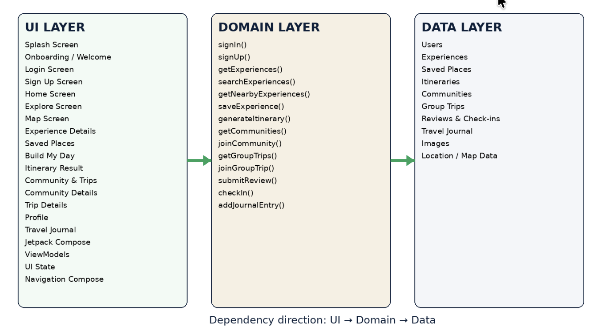

# LocalLens – System Architecture

## 1. Architecture Overview

LocalLens follows a three-layer architecture consisting of:

1. UI Layer
2. Domain Layer
3. Data Layer

Each layer has a specific responsibility to keep the application organized and maintainable.

The dependency direction is:

UI Layer → Domain Layer → Data Layer

## 2. Architecture Diagram

## 3. UI Layer

The UI Layer is responsible for displaying application screens,
handling user interactions, and managing UI state.

Key components:
- Jetpack Compose
- ViewModels
- UI State
- Navigation Compose (NavHost)

The UI Layer includes screens such as:
- Splash and Onboarding
- Login and Sign Up
- Home and Explore
- Map and Experience Details
- Saved Places
- Build My Day and Itinerary Result
- Community and Trips
- Profile and Travel Journal

The UI Layer does not directly access data sources.

## 4. Domain Layer

The Domain Layer contains the application's feature functions
and business logic.

Main functions include:
- signIn()
- signUp()
- getExperiences()
- searchExperiences()
- getNearbyExperiences()
- saveExperience()
- generateItinerary()
- getCommunities()
- joinCommunity()
- getGroupTrips()
- joinGroupTrip()
- submitReview()
- checkIn()
- addJournalEntry()

The Domain Layer communicates with the Data Layer through
repository interfaces and does not depend on UI implementation.

## 5. Data Layer

The Data Layer provides and stores application data.

It includes:
- User data
- Experiences
- Saved Places
- Itineraries
- Communities
- Group Trips
- Reviews and Check-ins
- Travel Journal entries
- Images
- Location and Map Data

Planned services include:
- Firebase Authentication
- Firebase Realtime Database
- Firebase Storage
- Google Maps SDK
- Fused Location Provider

The Data Layer does not contain UI logic.

## 6. Unidirectional Data Flow

Example: Experience Details Screen

UI State:
Loading → Success → Error (if data cannot be loaded)

User events:
- Open experience
- Save experience
- Request directions
- Check in
- Write review

The screen observes UI state from its ViewModel.
User actions are sent to the ViewModel, which calls the
appropriate domain function.

The Domain Layer accesses the Data Layer through repositories.
The result updates the UI state, and the screen displays
the updated information.

## 7. Feature Walk-through: Saving an Experience

1. UI Layer:
   The user taps the save icon on Experience Details.

2. UI / ViewModel:
   The ViewModel receives the save event.

3. Domain Layer:
   saveExperience() is called with the selected experience.

4. Data Layer:
   The repository stores the saved place in the data source.

5. Domain / ViewModel:
   The result is returned and the saved state is updated.

6. UI Layer:
   The screen reflects the saved state, and Saved Places
   can display the saved experience.

## 8. Architecture Summary

The three-layer architecture separates user interface,
application logic, and data management.

This structure helps LocalLens organize its features
and maintain a clear flow of information between layers.
